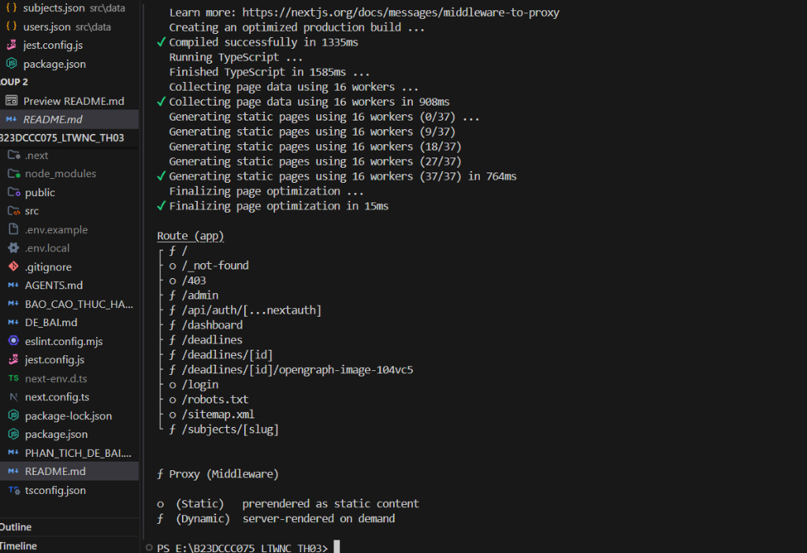
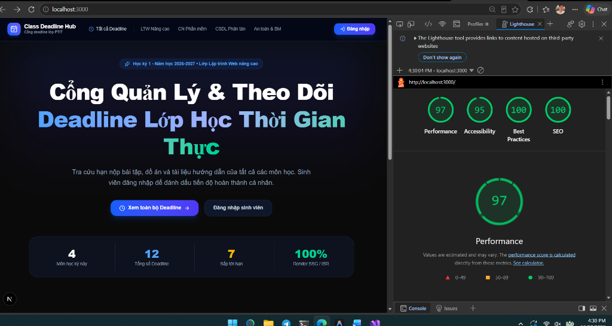
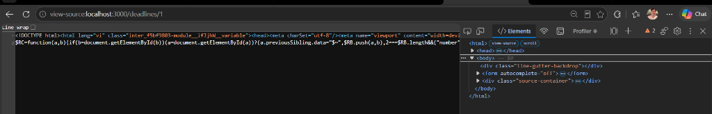

# Class Deadline Hub - BTH03 LTWNC
**Sinh viên:** B23DCCC075 • **Môn:** Lập trình Web nâng cao

---

## 1. Cách chạy dự án

```bash
npm install     # Cài đặt thư viện
npm run dev     # Chạy môi trường dev tại http://localhost:3000
npm run build   # Build bản production
npm test        # Chạy unit test Jest cho hàm can() (Điểm cộng)
```

**Tài khoản kiểm thử:**
- **Admin (Lớp trưởng):** `admin@ptit.edu.vn` / `admin123`
- **User (Sinh viên):** `sv@ptit.edu.vn` / `sv123456`

---

## 2. Kết quả `npm run build` & Lý do chọn chiến lược Rendering



| Route | Chiến lược | Lý do chọn |
| :--- | :---: | :--- |
| `/` | **SSG** | Nội dung giới thiệu tĩnh, ít thay đổi, render sẵn giúp tải trang tức thì. |
| `/subjects/[slug]` | **SSG** | 4 môn học cố định, dùng `generateStaticParams` để tạo sẵn HTML khi build. |
| `/deadlines` | **ISR (60s)** | Danh sách bài tập cần cân bằng tốc độ và độ mới; tự động làm mới sau mỗi 60 giây. |
| `/deadlines/[id]` | **On-demand ISR** | Chi tiết bài tập được tạo trước; tự động cập nhật ngay khi admin thêm/xóa bài tập (`revalidatePath`). |
| `/dashboard` | **SSR** | Dữ liệu cá nhân hóa (tiến độ từng sinh viên), cần lấy session trên mỗi request. |
| `/admin` | **SSR** | Trang quản trị thay đổi liên tục và yêu cầu kiểm tra quyền nghiêm ngặt trên mỗi request. |

---

## 3. Điểm đo kiểm Lighthouse



- **Performance:** 97 / 100
- **Accessibility:** 95 / 100
- **Best Practices:** 100 / 100
- **SEO:** 100 / 100

---

## 4. Minh chứng `view-source` của `/deadlines/1`



*(HTML được render sẵn từ server kèm metadata Open Graph và cấu trúc JSON-LD BreadcrumbList).*

---

## 5. Trả lời 2 câu hỏi lý thuyết

### (1) Vì sao `/deadlines/[id]` dùng ISR?
- **Tránh nhược điểm của SSG thuần:** SSG chỉ sinh HTML lúc build; khi admin thêm/xóa bài tập thì trang sẽ không cập nhật được trừ khi phải build lại toàn bộ dự án.
- **Tránh nhược điểm của SSR thuần:** SSR phải render lại component trên mỗi request, dễ gây nghẽn server và tải chậm khi cả lớp cùng truy cập trước giờ nộp.
- **Lợi ích ISR:** Tốc độ tải siêu nhanh như trang tĩnh (cache CDN), chuẩn SEO, đồng thời cập nhật tức thì dữ liệu mới nhờ cơ chế On-demand Revalidation (`revalidatePath`).

### (2) Nếu chỉ dùng Middleware để bảo vệ `/admin` thì có rủi ro gì?
- **Server Actions bị bỏ lọt:** Middleware chỉ lọc request theo URL. Kẻ xấu có thể gửi request POST trực tiếp đến các Server Actions (thêm/xóa deadline) qua cURL/Postman mà không cần mở trang `/admin`.
- **Rủi ro cấu hình matcher:** Dễ bị sót route do lỗi regex hoặc cấu hình thiếu.
- **Vi phạm nguyên tắc Defense-in-depth:** Cần bảo vệ đa tầng bằng cách kiểm tra quyền `can(role, action)` ngay tại trang `/admin` và bên trong từng Server Action, kết hợp xác thực dữ liệu đầu vào bằng Zod.

---

## 6. Điểm cộng đã thực hiện (+1 điểm)
- [x] **Unit test Jest cho hàm `can()`:** Đạt 14/14 tests (`npm test`).
- [x] **Đăng nhập GitHub (OAuth):** Đã tích hợp provider GitHub trong `src/auth.ts`.
- [x] **Sẵn sàng deploy Vercel:** Code chuẩn Next.js App Router, không lỗi runtime.
